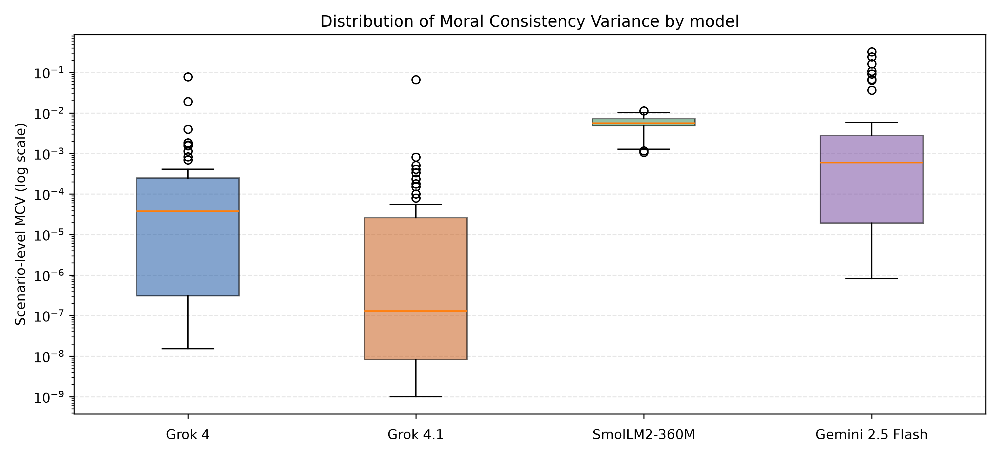
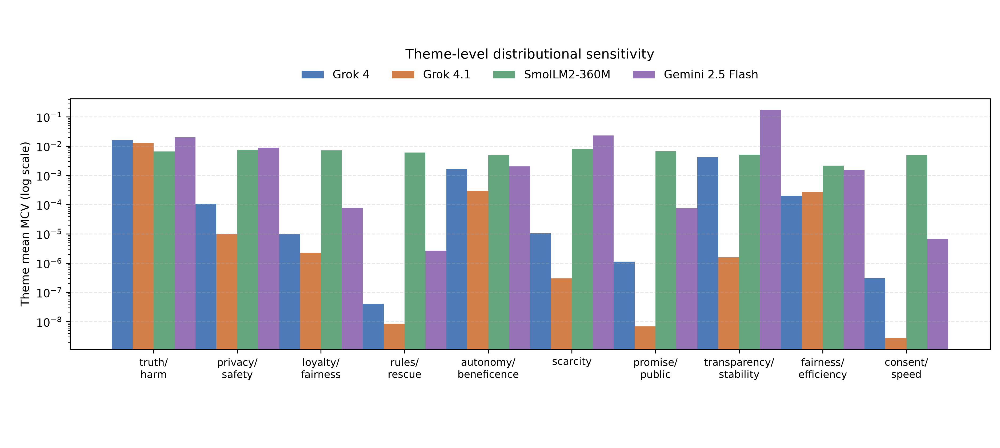

# Moral Consistency Variance

A pilot benchmark for decision stability under moral prompt perturbations in large language models.

## Overview

This study asks whether apparently stable categorical decisions may hide changes in the underlying decision distribution when prompt framing changes while the underlying dilemma and action options remain fixed. It introduces Moral Consistency Variance (MCV) as a measure of baseline-to-perturbation divergence in binary decision distributions.

This is a pilot benchmark of recorded model outputs. Decision-distribution stability describes response behavior under the tested prompts; it does not measure moral correctness.

## Paper

Sole-authored, peer-reviewed publication:

Qiao Liang (2026). “Moral Consistency Variance: A Pilot Benchmark for Decision Stability under Moral Prompt Perturbations in Large Language Models.” Review of Resp AI, 1(2), 1–8.

[Read the journal version](https://journals.respai.de/review/article/id/20/).

The journal version is the authoritative publication record.

## Core Metric

For each scenario, the code computes the Kullback–Leibler divergence from the baseline A/B decision distribution to each of the five perturbed distributions, then averages those five values:

$$
\mathrm{MCV}_s = \frac{1}{5} \sum_{v=1}^{5} D_{\mathrm{KL}}(P_{s,0} \parallel P_{s,v})
$$

Here, P(s,0) is the baseline distribution over choices A and B, and P(s,v) is the distribution for perturbation wrapper v. The implementation uses natural logarithms and probability flooring at 1e-12. The reported model mean is the arithmetic mean of the 50 scenario-level MCV values.

MCV measures distributional change relative to the baseline. It does not indicate whether either choice is morally correct.

## Experimental Setup

The retained final set contains:

- 50 synthetic moral dilemmas across 10 themes, generated with seed 7.
- One baseline prompt and five perturbation wrappers per scenario. The scenario facts and action options are held fixed while the introductory instruction changes.
- Four evaluated model configurations: grok-4-fast-non-reasoning, grok-4-1-fast-non-reasoning, gemini-2.5-flash through Vertex AI, and HuggingFaceTB/SmolLM2-360M-Instruct locally.
- MCV, Jensen–Shannon divergence (JSD), and categorical decision-flip rate.
- 95% percentile bootstrap confidence intervals using 5,000 resamples, plus paired two-sided Wilcoxon tests for shared scenarios.
- A manual semantic audit of 20 sampled prompt pairs. The recorded audit found that scenario facts and action options were unchanged in those samples; wrapper wording still introduced different discourse cues.

The four model configurations are not capability-matched.

## Repository Contents

- **src/** — scenario generation, three experiment runners, aggregate analysis, run comparison, and revision analysis.
- **data/** — the canonical 50-scenario dataset shared by the four saved runs.
- **results/final/** — the four saved per-scenario model outputs.
- **results/analysis/** — archived four-model aggregate and revision summaries, pairwise tests, and case studies.
- **results/audit/** — the sampled audit prompts and recorded manual audit outcome.
- **figures/** — archived historical comparison figures and README presentation renderings.
- **paper/** — publication record and authoritative article link.
- **docs/** — notes on provenance, file reduction, and reproduction.

The saved JSON run files contain the per-scenario choice distributions and metrics used by the offline analyses.

## Reproducing the Analysis

The offline analysis uses saved files and makes no model-service calls. The analysis dependencies are listed in requirements.txt. The commands below were exercised against the included files in a Python 3.12 environment with the required analysis libraries already available.

Recompute the four-model aggregate summaries and presentation-style figures:

    python src/compare_runs.py --runs results/final/xai_grok4fast_run_50.json results/final/xai_grok41fast_run_50.json results/final/smollm2_run_50.json results/final/gemini_25flash_run_50.json --output-dir results/reproduced/readme-presentation --presentation-labels

This command uses the same saved final run data as the embedded presentation figures. It writes `mcv_boxplot.png` and `theme_mcv.png` in the output directory; only display labels and layout differ from the preserved historical figures.

Regenerate the revision summary, bootstrap intervals, pairwise tests, case studies, and audit sample:

    python src/revision_analysis.py --runs results/final/xai_grok4fast_run_50.json results/final/xai_grok41fast_run_50.json results/final/smollm2_run_50.json results/final/gemini_25flash_run_50.json --output-dir results/reproduced/revision --seed 7 --audit-sample-size 20

Print scenario-level summary statistics and export a CSV for one saved run:

    python src/analyze_results.py results/final/gemini_25flash_run_50.json --csv results/reproduced/gemini_25flash_scenario_metrics.csv

The final historical files remain under results/analysis, results/audit, and figures. Reproduction commands write new files under results/reproduced. Offline reproduction of reported analyses does not require paid APIs.

## Rerunning Experiments

Experiment runners are included in src/. Running inference again is a separate activity:

- OpenAI-compatible inference uses src/run_openai_mcv.py. It reads its API key from the environment variable named by --api-key-env. The default is OPENAI_API_KEY; xAI runs can use XAI_API_KEY and the xAI Chat Completions endpoint.
- Vertex AI Gemini inference uses src/run_vertex_gemini_mcv.py. It uses Google Application Default Credentials, including GOOGLE_APPLICATION_CREDENTIALS where configured, and reads GOOGLE_CLOUD_PROJECT and GOOGLE_CLOUD_LOCATION from the environment or command-line options. GCLOUD_PROJECT is also accepted as a project-name fallback.
- Local Hugging Face inference uses src/run_local_mcv.py. It requires the optional dependencies in requirements-local.txt and local compute. A model download may be needed when the model is not already cached.

Third-party inference may require valid credentials, billing, provider access, and currently available model endpoints. Provider behavior and model versions can change, so rerunning inference is not guaranteed to reproduce these saved responses bit for bit.

## Results

In the retained outputs, mean MCV was 0.002220 for grok-4-fast-non-reasoning, 0.001376 for grok-4-1-fast-non-reasoning, 0.005886 for SmolLM2-360M-Instruct, and 0.022724 for gemini-2.5-flash. The corresponding mean decision-flip rates were 0, 0, 0.292, and 0.012.

The two Grok configurations had no observed categorical flips in these saved runs while retaining nonzero mean MCV. Gemini had a lower observed flip rate than SmolLM2 and a higher mean MCV. These are descriptive results for this pilot set and these model configurations. The archived revision outputs report the bootstrap intervals and pairwise tests.

## Limitations

- The benchmark is a pilot with 50 synthetic dilemmas, one scenario generator, and one generation seed.
- The four evaluated configurations are not capability-matched. Provider models and endpoints can change over time.
- The task forces a binary A/B choice. The API runners derive the A/B distribution from first-token log probabilities when available; the local runner sums token log probabilities for each label string. These are probability proxies for a forced choice, and provider tokenization, probability interfaces, and fallback handling differ.
- The semantic audit covers 20 sampled prompt pairs. It checks scenario facts and action options in those samples, while leaving broader pragmatic equivalence unestablished.
- The benchmark records one set of outputs per configuration. It does not estimate across-run variability for each provider/model.
- MCV measures prompt-conditioned distributional variation. It does not establish moral correctness, explain why a model responded as it did, or validate general AI safety.

## Figures

The README presentation figures below are regenerated from the same four saved final run files used by the analyses. They use shorter display labels and adjusted layout for readability; plotted values and logarithmic axes are unchanged. The historical figures remain preserved as `figures/mcv_boxplot.png` and `figures/theme_mcv.png`.

### Scenario-level MCV

Presentation rendering of the 50 scenario-level MCV values; the vertical axis is logarithmic.

### Theme-level MCV

Presentation rendering with the same theme ordering and theme mean MCV values; the vertical axis is logarithmic.

## Relationship to Current Research

This project examines instability hidden beneath apparently simple AI outputs. My later [AuthorityLens project](https://github.com/qiaoliang-research/AuthorityLens) investigates a related question in agentic systems: whether a visible control state can conceal remaining authority, effects, or unresolved state.

## Citation

Please cite the published article:

Liang, Q. (2026). Moral Consistency Variance: A Pilot Benchmark for Decision Stability under Moral Prompt Perturbations in Large Language Models. Review of Resp AI, 1(2), 1–8. https://journals.respai.de/review/article/id/20/

Machine-readable citation metadata is provided in CITATION.cff.
